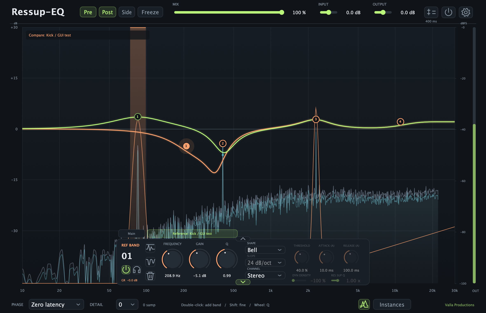

# Ressup-EQ

**Hear where tracks compete. Make room for both.**

Kick and bass fill the same low end. A vocal gets buried when the guitars come
in. A synth turns sharp as the filter opens. Ressup-EQ helps you shape the tone,
control the moments that jump out, and see how two tracks fit together.

Use **EQ**, **Dynamics** and **Res Sup** across up to **24 bands**. Bring another
track into the analyzer, see where their frequencies overlap,
and adjust either instance's EQ from the same window while listening to the mix.

Made by **Francesco Valla · Valla Productions**.

**Version 1.20.9** · macOS Apple Silicon: VST3 / AU · Windows x64: VST3 · Linux x86-64: CLAP

**[Download Ressup-EQ 1.20.9](https://github.com/vallaproductionsoriginal-byte/Ressup-EQ/releases/tag/v1.20.9)**

*Green: the current track's EQ. Brick: the selected reference. Vertical highlights:
frequencies where the two signals overlap.*

## New in 1.20.9

Mix is the same size as Input and Output. Compare and Instances now sit in the
header, between Freeze and Mix. At the -120 dB analyzer minimum, silence stays
flat instead of producing a rising high-frequency line.

## Retained from 1.20.8

Disabled bands stay gray and selectable, and keep their settings until you
explicitly delete them. Click the **Q** label to show or hide the band's curve
projection; red means visible. This also works with reference bands.

Deep Dynamics and Res Sup responses no longer flatten at the edge of the
standard **±30 dB** EQ scale. The scale stays fixed, and changing Range leaves
the spectrum unchanged. Existing sessions remain compatible.

## Retained from 1.20.4

Res Sup detects resonant peaks more reliably on notes and chords, with a more
consistent response across pitches. Existing settings remain compatible.

## Retained from 1.20.2

**Very broad Res Sup corrections now remain visible.** At minimum Res Sup Q,
some low-frequency corrections were audible but missing from the main and
reference response curves. Both curves now show the same adaptive voices
that are processing the audio.

Standard, Dynamics, Res Sup and Dynamics + Res Sup have been verified together
on one combined curve, with mixed configurations from **1 to 24 bands**.
The regression matrix covers **3,168 audio configurations**, **40,560 curve
configurations**, **48 live mode transitions** and **840 interface renders**.
The four-mode assignments on four bands are exhaustive; continuous controls
are sampled at representative values and limits. Saved settings remain compatible.

## Retained from 1.20.1

**Low Cut + High Cut now keeps the intended passband.** Bands process in
series, so combining curves no longer produces the unintended notch caused
by the previous parallel sum. The main and reference curves follow the same
routing, including Left/Right and Mid/Side, in all three phase modes.

For cuts, **0 dB/oct is neutral**, **6 dB/oct has the correct normalized
cutoff**, and **Brickwall is a finite 192 dB/oct approximation**. Linear mode
uses a finite FIR; higher Detail improves sharp transitions.

Saved settings still load. Sessions with multiple bands can sound different
because their combined filtering is now corrected. Solo keeps its existing
band-contribution audition.

## Make room for kick and bass from one window

1. **Put Ressup-EQ on both tracks and play the section together.** Open the
   bass instance, for example, with the kick running through its own instance.
2. **Click Instances at the bottom, beside Valla Productions.** The browser
   shows **External sidechain** first, **Main** (the instance you opened) next,
   then the other live instances. Each has a spectrum and applied EQ preview.
   Give instances track names so the kick, bass and other parts are easy to find.
3. **Select the kick and enable the Compare icon, just left of Instances.**
   Its spectrum overlays the bass spectrum. Vertical highlights grow
   wider and stronger where the two signals compete for the same frequencies.
4. **Choose which track should own that area.** Listen for the kick's weight
   and the bass's body. The highlights give you a place to investigate;
   overlapping energy can also be exactly what the arrangement needs.
5. **Shape either EQ without opening another window.** The bass EQ stays
   green; the kick's reference EQ is brick-coloured. Use **Main / Reference**
   above the band panel, or click a band node, to choose which instance to edit.
   Drag for frequency and gain, wheel for Q, or use the band controls. Add and
   delete bands in the selected instance as needed.

**Editing Reference changes that track's actual EQ and sound.** Those changes
are saved with the target instance, even when its editor is closed. Switching
back to Main lets you continue shaping the track whose window you opened.
Turning Compare off also returns editing to Main.

The competition display helps you decide where to work. It does not apply
cuts or duck another track automatically.

## Try the comparison on the rest of the mix

| Tracks | Listen for | Try |
| --- | --- | --- |
| **Kick + bass** | A low end that gets heavy or loses definition when both play | Keep the weight of one part and gently shape the other around it. |
| **Lead vocal + guitars or pads** | Words getting buried when the arrangement fills out | Compare the presence area, then adjust the backing part's reference EQ while the vocal plays. |
| **Synth layers** | A harsh or crowded region that appears when layers combine | Decide which layer needs that character, then shape the other. |
| **Backing vocals + lead** | Extra thickness that starts hiding the lead | Compare their low mids and presence before choosing where to make room. |

For a build-up that happens only on louder moments, try **Dynamics** in the
band you have chosen. For ringing peaks inside that area, try **Res Sup**.
You can use both on the same band, with Dynamics processing first.

## Compare a sidechain signal

To compare against audio that does not have its own Ressup-EQ instance, route
that track into the plug-in's **external sidechain input in your DAW**. Choose
**External sidechain** at the top of Instances, then enable Compare.

The analyzer compares the current track's processed **Post** signal with that
sidechain signal. When another Ressup-EQ instance is selected instead, it
compares the two instances' Post signals.

A sidechain source provides audio for the comparison. To edit another track's
EQ from this window, select that track's **Ressup-EQ instance** as the reference.
To have incoming sidechain audio trigger a band's Dynamics or Res Sup, enable
that band's **External SC** control in Details as well.

## Start with what you hear

| What the track needs | Reach for | Try it on |
| --- | --- | --- |
| A lasting change in tone | **EQ** | Low-mid cleanup, bass weight, vocal presence or a brighter top end |
| Control when a frequency gets too loud | **Dynamics** | Boomy bass notes, louder vocal phrases or a synth that gets harsh as it opens up |
| Control over individual resonant peaks | **Res Sup** | Ringing vocals, sustained synths or narrow peaks inside a busy sound |

Each band has its own frequency, gain, Q and channel selection. Choose bells,
shelves, low/high cuts, notches, band-pass, tilt shelves, flat tilt or all-pass
shapes. For cuts, slope choices include gentle **6 dB/oct**, steeper options and
**Brickwall**. Use Solo to hear a band's contribution while finding the area.

## Get a band working in a few moves

1. **Find the area.** Double-click the spectrum to add a band. Drag the point
   to set frequency and gain; use the wheel over it to adjust Q.
2. **Choose how it reacts.** Leave it as regular EQ, enable Dynamics, enable
   Res Sup, or turn both on.
3. **Set the direction.** Negative Density cuts; positive Density boosts.
   Res Sup starts at **0%**, so move Density below zero to hear suppression.
   Dynamics starts at **−100%**, ready to attenuate above its threshold.
4. **Set a useful limit.** Open the Details drawer and choose a modest Range,
   such as **−6 dB**. Raise Threshold while listening, then adjust Density
   until the band does enough for the mix.
5. **Compare at a similar level.** Use the Loudness Match icon beside Output,
   then the power-shaped Bypass icon to compare the processed and original signal.

Hold **Shift** for finer dragging and wheel moves. Type directly into numeric
fields, including frequencies in kHz. Double-click a control to reset it.
Select a band and use **Delete / Backspace** or the bin icon to remove it.
The lower arrow folds the parameter panel when you want more room to look
at the spectrum.

## Let Dynamics and Res Sup work together

You can now enable both on the **same band**, with this routing:

**Dynamics → Res Sup**

On a vocal, for example, use Dynamics to contain an upper-mid build-up on
louder words, then let Res Sup work on the resonant peaks within that area.
The internal Res Sup detector accounts for the level change made by Dynamics.
You can also use either stage on its own.

When both are active, click **Edit: Dynamics / Edit: Res Sup** above the
parameter panel to choose which stage's **Threshold and Density** you are
adjusting. Each stage remembers its own values. **Range, Attack, Release and
Auto timing are shared** within the band.

Your regular EQ gain stays available for setting the overall tone alongside
the adaptive processing.

## Get the amount and movement right

**Range sets the available depth.** It runs from **0 to −72 dB**, with new
bands starting at **−32 dB**. For a first pass, bring it closer to zero and
increase the available depth as you listen.

**Threshold sets when and how much.** Higher Threshold percentages
let quieter material trigger the processing and increase the available action.
At full negative Density, **Range −6 dB + Threshold 50%** allows up to **3 dB
of cut**. The amount you actually hear depends on the signal and the band's
sensitivity. Positive Density applies the same limit to boosts.

**Density decides the direction and strength.** Both stages run from **−100%
to +100%**: negative values attenuate, zero is neutral, and positive values
boost. Use negative Res Sup Density to tame resonances; try positive values
when you want to bring out resonant character.

**Attack and Release set the movement.** Attack controls how quickly the
correction engages; Release controls how it returns. Leave **Auto timing**
on as a starting point, or adjust either control to switch to manual timing.

**Main Q and Res Sup Q do different jobs.** Main Q focuses the band and its
sensitivity around the chosen frequency. **Res Sup Q** sets the width of the
individual adaptive corrections: lower values make them broader, higher values
make them narrower. The range is **0.01x–4x**, with **1x** as the default.

## Choose what the band listens to and where it works

Set a band to **Stereo, Left, Right, Mid or Side**. For example, choose Mid
to work on the centre of a stereo sound, or Side to address the wider part
of a synth or bus.

In the Details drawer, **External SC** lets another signal trigger the band's
adaptive processing. Route that signal to the plug-in's side-chain input in
your DAW, then enable External SC. **SC filter**, **SC Low** and **SC High**
focus the detector on a frequency range. These controls shape what the
detector listens to.

## Use the analyzer to support your ears

**Pre and Post** show the input and output spectra. **Side** shows the stereo
difference signal, useful for seeing what's happening away from the centre.
The Side trace and the external side-chain input are separate controls.

**Freeze** remembers the highest Post peaks while the live analyzer keeps
moving. Hover near a remembered peak to read its frequency; click to add a
neutral band there. Turning Freeze off clears the memory.

Open the **gear icon** in the header to adjust the view:

| Setting | Use it for |
| --- | --- |
| **Resolution: 1024–65536 samples (64k)** | Raise it to distinguish closely spaced frequencies, especially in the low end. Default: **16384**. |
| **Minimum: 0–120 dB below 0 dBFS** | Choose how far down the spectrum you can see. The default value **100** shows **0 to −100 dBFS**. |
| **Speed: Very Slow → Very Fast** | Slow the rise and fall for an easier trace to read, or speed it up to follow changes more closely. |

Click outside the menu to close it. These are display settings: changing them
leaves the audio processing and plug-in latency unchanged.

One combined curve shows the EQ and Mix response, including live adaptive
corrections. The EQ gain axis stays at **±30 dB**. Input and Output trims
change your listening level without moving that curve away from the band's
settings.

## Judge changes at a similar level

Use **Input** and **Output** to manage levels and **Mix** to blend the
processed signal with the original for parallel treatment.

The **Loudness Match** icon adjusts the output toward the input's momentary
loudness, so you can judge the change with less distraction from a level jump.
It includes EQ, Mix and trims in the comparison and leaves your manual Output
setting in place. Use **Bypass** to check the original signal as you work.

## Pick a processing mode for the session

- **Zero latency + Detail 0:** a starting point for recording and playing
  instruments when you need a responsive signal path.
- **Natural:** 2× oversampling; compare this mode by ear as you work on the tone.
- **Linear:** linear-phase processing with added latency. Try higher Detail
  when very narrow corrections need more frequency precision.

The **Detail 0–5** control at the bottom changes processing precision.
Higher settings use more CPU and can add latency. The **Resolution** setting
in the gear menu changes the analyzer picture. Choose each according to what
you need to hear and see.

## Bring an existing session up to 1.20.9

Update **all instances you want to compare to 1.20.9**. Your existing EQ and
processing settings remain compatible. The Instances browser can also show
live instances in another open DAW project, so track names help you choose.

Compare on/off is saved with the session. Instance names and the chosen source
last while the plug-in is loaded; **select your reference again after reopening
a project**. If the reference closes, its highlights clear and editing returns
to Main.

See the [changelog](CHANGELOG.md) for the release history.

## Download and install

Choose your format, extract the ZIP and copy the plug-in to the folder below.
Close your DAW before replacing an existing version, then reopen it and rescan
plug-ins if needed. Copy the **entire VST3 or AU bundle**; on Linux, copy the
single **Ressup-EQ.clap** file. The AU includes its engine and works without a
separate VST3 installation.

| Download | Requirements | Installation folder |
| --- | --- | --- |
| [Mac VST3](https://github.com/vallaproductionsoriginal-byte/Ressup-EQ/releases/download/v1.20.9/Ressup-EQ-1.20.9-macOS-AppleSilicon-VST3.zip) | macOS 14+, Apple Silicon | `~/Library/Audio/Plug-Ins/VST3/` |
| [Mac AU](https://github.com/vallaproductionsoriginal-byte/Ressup-EQ/releases/download/v1.20.9/Ressup-EQ-1.20.9-macOS-AppleSilicon-AU.zip) | macOS 14+, Apple Silicon | `~/Library/Audio/Plug-Ins/Components/` |
| [Windows VST3](https://github.com/vallaproductionsoriginal-byte/Ressup-EQ/releases/download/v1.20.9/Ressup-EQ-1.20.9-Windows-x64-VST3.zip) | Windows 10/11, x64 | `C:\Program Files\Common Files\VST3\` |
| [Linux CLAP](https://github.com/vallaproductionsoriginal-byte/Ressup-EQ/releases/download/v1.20.9/Ressup-EQ-1.20.9-clap.1-Linux-x86_64-CLAP.zip) | Linux x86-64, glibc 2.35+ (Ubuntu 22.04+), X11/XWayland | `~/.clap/` |

On Linux, create `~/.clap/` if needed and use a DAW with CLAP support.
Standard fontconfig, FreeType and X11 desktop libraries are required; on
Wayland, the DAW must host the editor through X11/XWayland. The Linux package
is for x86-64.

The Mac plug-ins have passed VST3 and AU validation. Mac downloads are ad-hoc
signed and are **not Apple notarized**. The Windows x64 build has passed
binary checks; **testing in a Windows DAW remains pending**. The Linux CLAP
has passed audio and interface tests, CLAP validation, and loading and audio
rendering in REAPER. Its ZIP includes the verification details.

Downloads contain compiled plug-ins, installation information and licenses.
**Project source code is not distributed.** File checksums are available in
[SHA256SUMS.txt](SHA256SUMS.txt).

## Credits and license

Created by **Francesco Valla · Valla Productions**.
Original Ressup-EQ software and documentation are [proprietary](LICENSE).
© 2026 Francesco Valla. All Rights Reserved. Use requires express authorization
under this license or a separate written agreement. Third-party components
retain their own licenses; see [Third-Party Notices](THIRD_PARTY_NOTICES.md).
