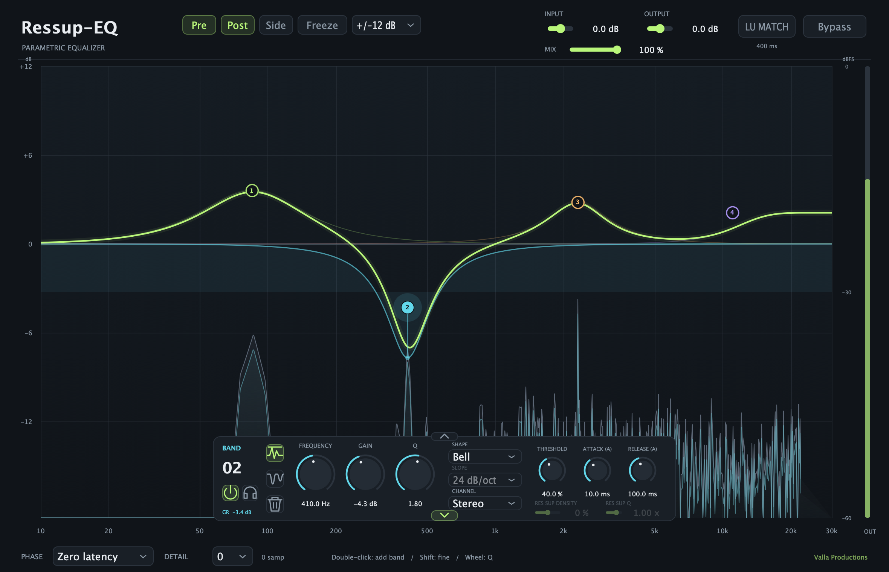

# Ressup-EQ

**Shape your tone. Tame resonances. Stay focused on the music.**

Ressup-EQ by **Valla Productions** brings a 24-band equalizer, dynamic EQ and
resonance suppression into one visual workspace. Use it to smooth a sharp vocal,
control ringing synths, tighten a bass part or bring balance to a bus.

**Version 1.16.1** · macOS Apple Silicon: VST3 / AU · Windows x64: VST3

## Three ways to shape your sound

- **EQ:** make a lasting tonal change. Add weight, clear some low mids or shape
  the top end with up to 24 bands.
- **Dynamics:** let a band react to the input level. Useful when a frequency
  builds up only on louder notes or phrases. Attack and Release shape how
  quickly the cut engages and recovers.
- **Res Sup:** follow several resonant peaks within the area you select. Use
  negative Density to reduce ringing and harshness, or positive Density to
  bring out resonant character. Density starts at **0%**; move it below zero
  to hear suppression.

Switch between Dynamics and Res Sup with the band's mode buttons. You can
still adjust its regular EQ gain while either mode is working.

## Get started in a few moves

1. **Find the area.** Double-click the spectrum to add a band. Drag its point
   to adjust frequency and gain; use the mouse wheel to change Q.
2. **Choose the response.** Use EQ for tone shaping, Dynamics for level-dependent
   control or Res Sup to work on resonant peaks inside the band.
3. **Dial in the amount.** In Res Sup, choose a negative Density. Set a modest
   Range in the Details drawer, then raise Threshold while listening.
4. **Compare by ear.** Turn on **LU MATCH** beside Output to bring the output
   toward the input's momentary loudness, then use Bypass to compare.

Click any band point to select it; use the lower panel’s arrow to show or hide
its controls. Hold **Shift** for finer edits; double-click a control to restore
its default.

## Make the controls work for your mix

**Range and Threshold work together.** Range sets the maximum available cut
at 100% Threshold. At full negative Density, Range **−30 dB** and Threshold
**50%** allow up to **15 dB** of reduction; at **100%**, up to **30 dB**.
Raising Threshold also makes quieter peaks eligible for processing. Actual
reduction depends on the signal and the band's sensitivity. New bands start
with Range at **−32 dB**.

**Q decides where to focus.** The main Q steers the area covered by the band.
**Res Sup Q** separately widens or narrows the corrections around individual
resonances. Use Attack and Release to match the movement to the performance,
or leave Auto timing enabled.

**See what you are hearing.** Pre and Post compare the input and output
spectra; Side shows the stereo difference signal. Freeze remembers Post peaks
while the analyzer stays live. Hover near a peak and click to add a band there.
Use Solo to audition a band's contribution. Choose the **±30 dB** display scale
when you want to see cuts deeper than the default ±12 dB view.

**Choose phase and detail for the session.** Zero latency keeps playback
responsive when recording or playing instruments. Natural is an oversampled
alternative; Linear offers linear-phase EQ with added delay. Detail starts
at **0**. Higher settings improve frequency resolution and use more CPU;
they can also add latency. Very narrow corrections in Linear mode may need
higher Detail.

## Download and install

Choose the ZIP for your system, extract it and copy the entire plug-in bundle
to the matching folder below. Close your DAW before replacing an existing
version, then reopen it and rescan plug-ins if needed.

| Download | Requirements | Installation folder |
| --- | --- | --- |
| [Mac VST3](Ressup-EQ-1.16.1-macOS-AppleSilicon-VST3.zip) | macOS 14+, Apple Silicon | `~/Library/Audio/Plug-Ins/VST3/` |
| [Mac AU](Ressup-EQ-1.16.1-macOS-AppleSilicon-AU.zip) | macOS 14+, Apple Silicon | `~/Library/Audio/Plug-Ins/Components/` |
| [Windows VST3](Ressup-EQ-1.16.1-Windows-x64-VST3.zip) | Windows 10/11, x64 | `C:\Program Files\Common Files\VST3\` |

The Mac VST3 and AU have been validated on macOS. The Windows build has
**not yet been tested in a Windows DAW**. Mac downloads are not Apple notarized.
File checksums are available in [SHA256SUMS.txt](SHA256SUMS.txt).

## Credits and license

Created by **Francesco Valla** · **Valla Productions**.
Original Ressup-EQ code and documentation: [MIT License](LICENSE),
© 2026 Francesco Valla. Third-party components retain their own licenses;
see [Third-Party Notices](THIRD_PARTY_NOTICES.md).

This private repository contains compiled plug-ins, the interface screenshot
and documentation. Source code is not included.
